# Review: UX, accessibility and look

*2026-10-19, on `polish-material` (PR #4). No app code changed by this review. The card-face fix the owner asked for
during the review is separate: PR #8.*

## Verdict

The menus already feel like the product we described: warm, calm, real materials, kind copy, a little joy on every
menu screen (the cupboard, the cork board, the fridge note, the stamp on the score pad). Nothing interrupts a hand, the
tap targets pass everywhere, and in nine configurations no text was clipped and no screen scrolled sideways.

Three areas are not ready, and they are the ones this audience will judge us on:

1. **Pass-and-play leaks a player's cards** through the "Pass the phone" cover. That breaks trust at the family table.
2. **A blind player cannot follow the game.** VoiceOver hears seat names but no bids, tricks or scores, it misses the
   last card of every trick, and its focus is left on screens that are no longer showing. DESIGN §6.0 promises the
   opposite, and so will the listing.
3. **Comfort mode on an iPhone SE has no room for the trick**, and the Comfort colours don't meet the 7:1 floor we set
   ourselves. Comfort is the feature caregivers turn on, so this is where Mom will play.

The table, where people spend 95% of their time, is the plainest screen in the app. It also never tells a new player
"your turn, tap a card". Fix the three areas above and the first-run prompts, and this earns its 5 stars.

## How it was checked

- Built `www/` and drove it with Playwright (WebKit, plus one Chromium run) through `www/index.html?debug&fast`:
  title, cupboard, setup (preset and Custom), table (Spades bid, play, select, Why?, score peek, menu; Hearts pass,
  play; a whole hand by autoplay), score sheet, results (won and lost), Fair deal, How to play, Options, Caregiver PIN
  and screen, Unlock, Table shop (all three scroll depths), Leaderboards, the grown-up gate, and the pass-and-play cover.
- Sizes and modes (screenshot prefix → configuration):

  | Prefix | Size | Mode |
  |---|---|---|
  | `pro-` | iPhone 17 Pro 402×874 | default |
  | `se-` | iPhone SE 375×667 | default |
  | `se-comfort-` | SE | Comfort |
  | `se-xl-` | SE | Text size Extra large |
  | `pro-comfort-xl-` | 17 Pro | Comfort + Extra large + four-colour deck |
  | `pro-large-chromium-` | 17 Pro, Chromium | Text Large + Reduce Motion |
  | `ipad-` / `ipad-comfort-` | iPad 820×1180 | default / Comfort |
  | `locked-` | 17 Pro | `?locked` (a new player who owns nothing) |

- **Contrast** was measured from rendered pixels, not CSS: each screen was shot once with text hidden, and every text
  run's colour (with its opacity) was compared with the background under it. The figure quoted is the 20th-percentile
  ratio over the run's area. The bar is WCAG AA 4.5:1 (3:1 for large text), and 7:1 / 4.5:1 in Comfort (DESIGN §6.1).
- **VoiceOver semantics** were read from the accessibility tree (Playwright `ariaSnapshot`) on every screen, plus a
  live-region log over a whole Spades hand at normal speed and keyboard focus tests. VoiceOver itself on a device is
  still owed (QUALITY_CHECKLIST F4).
- Screenshots: `docs/review/ux/` (jpg, 1×). They were taken before PR #8, so the cards in them have the old faces.

---

## P0: blocks launch

### P0-1 · Pass and play: the cover shows the last cards of the hand
- **Screen:** the "Pass the phone to Player 3" cover. 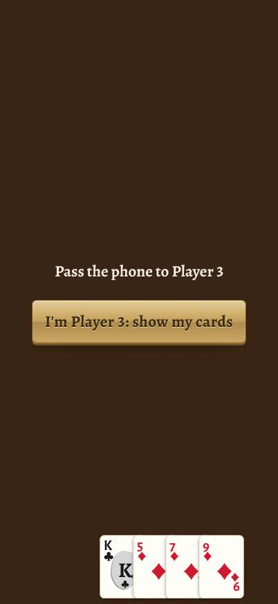
- **What's wrong:** the cover is `z-index: 8`, but each hand card gets an inline `z-index` of 0-12 inside the same
  stacking context. Cards 9-12 (the right end of the hand) draw on top of the cover. The cover is also only visual: the
  hand underneath stays in the accessibility tree.
- **Why it matters:** "Nobody sees another player's cards" (QUALITY_CHECKLIST B5, currently ✅) is the whole point of
  pass-and-play. The family plays it at a real kitchen table, so a leaked ace is noticed at once and remembered.
- **Fix:** give `#hand` its own stacking context (`#hand { z-index: 1 }`, or `isolation: isolate`) so its children can't
  rise above `#handoff`. Better still, clear `#hand` (and `#trick`) before the cover shows, and mark the rest of the
  table `inert` while it is up. Add a smoke check: with the cover up, `elementFromPoint` over the hand must hit the cover.

### P0-2 · VoiceOver hears names, not the game
- **Screen:** table. 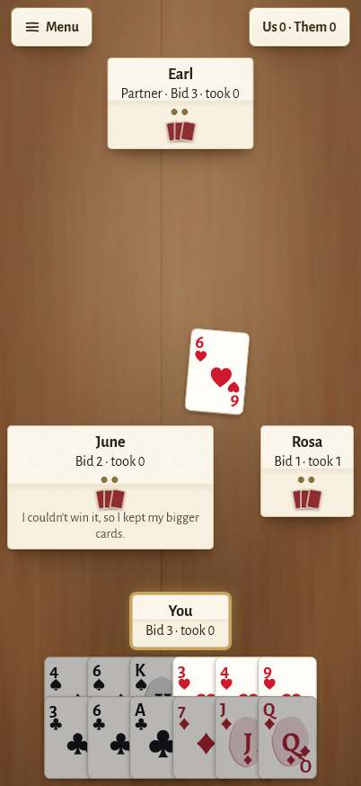
- **What's wrong:** each seat is a `<button aria-label="June">`. An aria-label replaces the content, so VoiceOver says
  "June, button": it never reads her bid, tricks taken, points, partner tag, level, whose turn it is, or the Why?
  sentence that appears inside the plate. The score chip is `aria-label="Score"`, which hides "Us 45 · Them 113". The
  pips' `aria-label` is on a bare ``, which VoiceOver ignores. Trick cards are buttons (`tabindex=-1`) named only
  by card, with no word on who played them.
- **Why it matters:** a blind Spades player can't know the bids, so they can't bid or play sensibly. "Works with
  VoiceOver" is in Options and will be on the listing, so this is the 1-star review that says "lied about accessibility".
- **Fix:** label seats with the whole state, rebuilt in `drawTable()`, for example: "June, opponent, Standard. Bid nil,
  took 0. Her turn. Double-tap to hear why she played." Label the score chip "Score: us 45, them 113. Double-tap for
  details." Give trick cards `role="img"` and labels like "June: ace of diamonds". Add a smoke check that no `.seat`
  accessible name is just the seat name.

### P0-3 · Announcements overwrite each other; VoiceOver users lose cards
- **Screen:** table, `announce()` in `main.js`.
- **What's wrong:** one `aria-live` region whose text is replaced each time. In `played()`, "Rosa played the 9 of
  hearts." is replaced in the same tick by "Rosa takes the trick.", so assistive tech only ever sees the second: **the
  last card of every trick is never announced**. The bots also move every ~0.5 s. Over one Spades hand at normal speed,
  45 of 58 announcements were replaced less than 1.5 s after they appeared, which is shorter than VoiceOver needs to
  read one. Bots wait for "Read the table aloud" (`speech.idle()`), but not for VoiceOver.
- **Why it matters:** blind and low-vision players are a named audience (DESIGN §6.0). A game where you miss a quarter
  of the cards played is unplayable.
- **Fix:** (a) combine the end of a trick into one sentence: "Rosa played the 9 of hearts and takes the trick."
  (b) Queue announcements and never replace one sooner than its estimated reading time (about 60 ms per character at
  rate 1). (c) When VoiceOver is running (`UIAccessibility.isVoiceOverRunning`, through a five-line Capacitor plugin or
  the iOS shell), make the bots wait for the queue, as they already do for the spoken table. (d) Add a "Last trick"
  item to the Read button and the menu.

### P0-4 · Focus is left on screens that are gone; dialogs don't take focus
- **Screen:** every navigation, the PIN pad, the menu, the gate, Restore, Reset stats.
- **What's wrong:** `show()` hides the old screen (`visibility: hidden; aria-hidden`), but focus stays on the button
  that was tapped. After Tab + Enter on "Games and rules", focus was still on that button inside the hidden title. When a
  dialog opens, focus is on `<body>`. The dialog has no `aria-labelledby`, and focus isn't returned when it closes.
- **Why it matters:** VoiceOver's cursor lands on nothing or on hidden content. The user has to scrub the screen to
  find out where they are, after every tap. Switch Control and keyboard users (some tremor users) have the same problem.
- **Fix:** in `show(id)`, focus the new screen's `h1` (give it `tabindex="-1"`). In `dialog()`, set
  `aria-labelledby` to the dialog's `h2`, focus that `h2`, make `main` `inert` while open, and return focus to the
  opener on close. At the table, focus "Your hand" when it's your turn.

### (Resolved) P0-5 · Card faces: the centre art covered the corner index
On all 54 faces, the centre pip or the court panel crossed the upside-down index, and the joker's label ran off the
card. Fixed in **PR #8** (clear centre column, round clubs, framed J/Q/K), with `scripts/check-cards.mjs` as a check.
Wire that check into CI.

---

## P1: fix before launch

### P1-1 · Comfort on iPhone SE: no room for the trick, and selected cards hide their neighbours
- **Screens:** 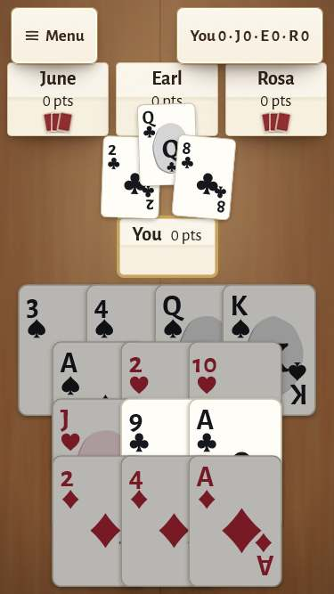 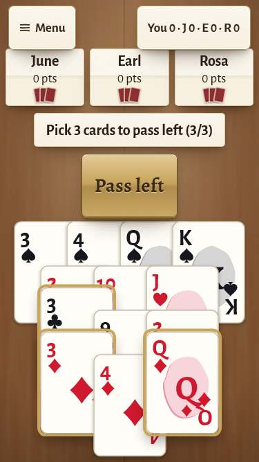
  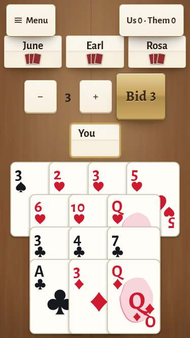
- **What's wrong:** the 1.6× hand takes four rows, more than half the screen. The trick is squeezed into roughly 150 px
  between the seat row and your name plate, and the top card covers Earl's "0 pts". A selected card lifts 22% and covers
  the indices of the cards above it, so while passing three cards you can't read the ones you haven't picked. During
  bidding, the "You" plate shows an empty second line.
- **Why it matters:** Comfort is the mode for older eyes and hands, and the SE is a common hand-me-down phone for a
  parent.
- **Fix:** in Comfort, show the selection with a thick brass outline and a "Selected" tab instead of lifting the card.
  Make the "You" plate a one-line strip. Draw the trick as a row of four labelled cards under the seat row, each with
  the player's name, so it no longer competes with the hand. Make smoke `--se --comfort` fail when a trick card covers
  a seat or when a hand index is covered.

### P1-2 · Nothing on the table says "your turn, tap a card"
- **Screen:** 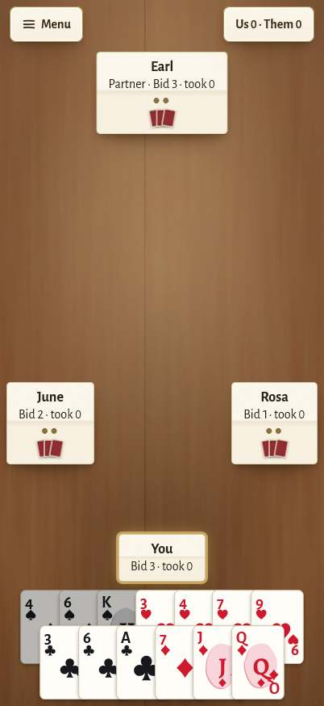
- **What's wrong:** on your turn to play, the centre of the table is empty. The only sign is a brass glow on your
  plate. "Your turn." goes only to the live region.
- **Why it matters:** first-run clarity. A 60-year-old new to the app sees a still table and wonders whether it froze.
  Younger players expect the playable cards to be obvious.
- **Fix:** put a say-box in the centre: "Your turn: tap a card" (Comfort: "Tap a card, then tap it again to play"). For
  the first few hands, give the playable cards a slow lift. Under Reduce Motion, show the say-box alone.

### P1-3 · "Why?" is hidden and pushes the seats around
- **Screens:**  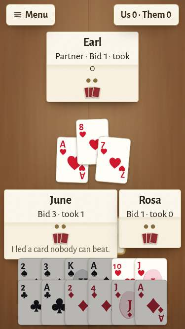
- **What's wrong:** nothing tells you a bot's plate can be tapped. When you do tap it, the sentence widens the plate
  (to about 230 px), and on SE with Extra large text it covers your own plate. The sentence is 14.7 px, below the 15 px
  floor.
- **Why it matters:** "Why?" is the feature that turns a frustrating partner into a teacher (QUALITY_CHECKLIST B4).
  Hidden, it might as well not exist.
- **Fix:** after a bot plays, show a small "Why?" tab on its plate. Show the answer in the centre say-box at ≥ `--fs-s`
  for a few seconds, or until the next card. Never resize the plate.

### P1-4 · The score peek covers your partner and outlives the game
- **Screens:** 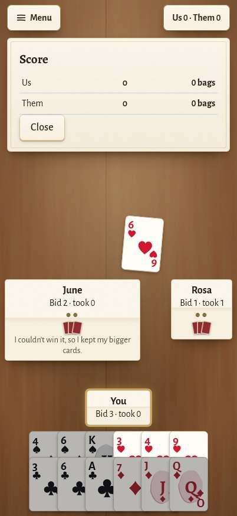 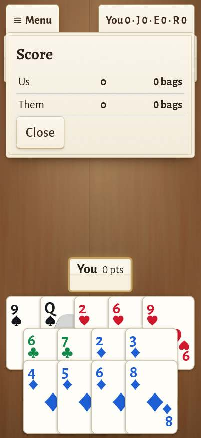
- **What's wrong:** the peek is drawn over the top seat. It isn't closed when the hand or the game ends, so a Spades
  "Us / Them / bags" peek was still open over the next Hearts game.
- **Fix:** close `#peek` in `startHand()` and `newGame()`. Place it as a sheet under the menu bar that pushes the seats
  down, or make it a full score-pad view.

### P1-5 · Comfort doesn't meet its own contrast and colour promise
- **Screens:** 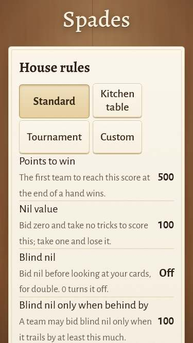 
- **What's wrong:** DESIGN §6.1 promises a 7:1 text floor and the four-colour deck in Comfort. In Comfort, the muted
  text (rule explanations, the seed line, the shop's notes, card-back captions) measures 5.3-5.9:1. Cream headings on
  the wood measure 3.4-3.9:1. The bid number in the Comfort stepper is dark ink straight on the felt at 3.8:1, and it
  is the most important number on that screen. Comfort doesn't turn on the four-colour deck or heavier suit glyphs.
- **Fix:** add `html.comfort { --muted: #3f362c; }` (and use a variable for `.muted`, `.tblurb`, `.backpick small`,
  `.recipe .from`). Give titles on wood a darker plate or a stronger shadow in Comfort. Put the stepper value on a paper
  chip. Make Comfort switch on the four-colour deck, as DESIGN §6.1 says.

### P1-6 · Switches: "off" is nearly invisible
- **Screen:** Options, Caregiver, Custom rules. 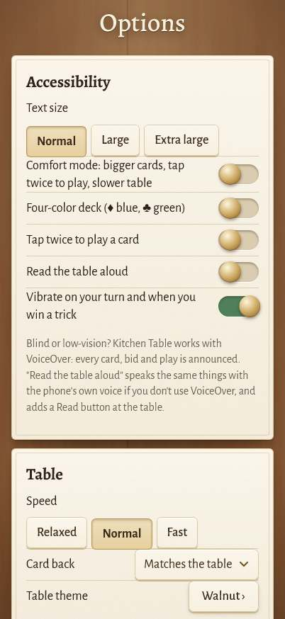
- **What's wrong:** the off track `#d9ccb0` on paper is 1.47:1. WCAG 1.4.11 asks 3:1 for the shape of a control. The
  state shows only as knob position and the green fill.
- **Fix:** give the track a 1.5 px border in `--brass-d`, and print "On" / "Off" in small caps beside the switch. Older
  users don't all read iOS switches.

### P1-7 · "End this game" ends it with one tap
- **Screen:** the menu. 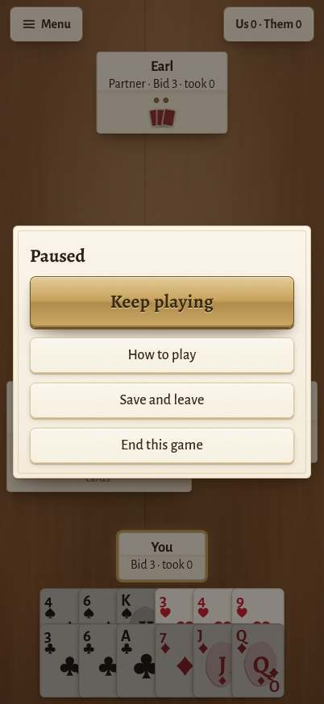
- **What's wrong:** outside Comfort, End this game has no confirm. It sits just under "Save and leave", which is what
  most people want.
- **Fix:** always confirm End ("End this game? Scores for this game are lost.") and keep Save and leave one tap.

### P1-8 · Setup: presets squeezed into half the width; Deal is two screens down
- **Screen:** 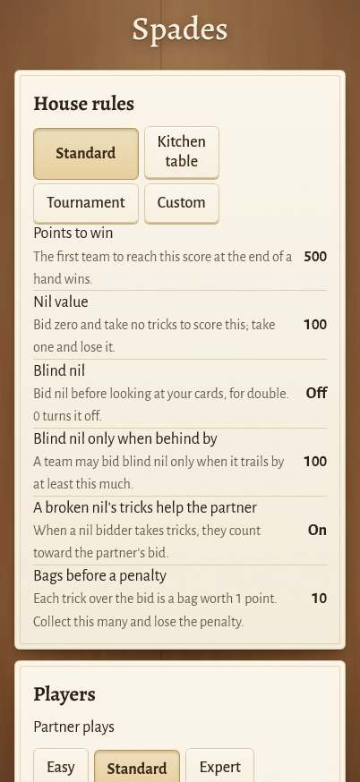
- **What's wrong:** the preset `.seg` sits inside `.grid2`, so it takes one column of two. "Kitchen table" wraps and the
  right half is empty. The setup screen is 1,539 px tall on an 874 px phone, and **Deal** is at the very bottom.
- **Fix:** drop the `.grid2` wrapper (or `grid-column: 1 / -1`). Pin a Deal bar to the bottom of the screen. Collapse
  the rule list to "Standard rules · 500 points, nil 100, bags 10 · See all".

### P1-9 · Buttons in groups have no group name, and selects have no label
- **Screens:** Setup, Options, Caregiver (accessibility tree).
- **What's wrong:** VoiceOver reads "Standard, selected" for Partner and again for Opponents, and "Computer, selected"
  three times for the seats, with nothing to say which is which. The Card back and Language selects have no label, so
  VoiceOver reads "Matches the table, pop-up button".
- **Fix:** give each `.seg` `role="radiogroup"` plus `aria-labelledby` pointing at its row label, with `role="radio"`
  and `aria-checked` on the buttons. Wrap each select's text in a `<label for>`.

### P1-10 · Shop: buy buttons say only "$2.99", and you can't try a table first
- **Screen:** 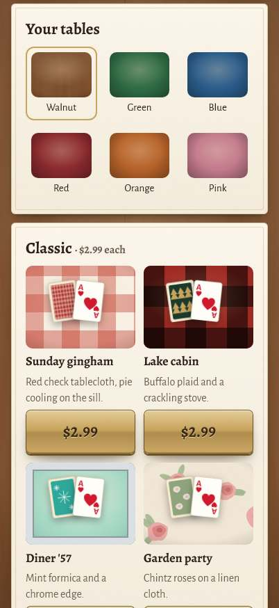
- **What's wrong:** VoiceOver reads each buy button as "$2.99, button", with no theme name. The big brass price plates
  are the loudest things in the shop. A theme can only be seen as a small tile.
- **Why it matters:** blind users shouldn't buy blind. A gift-buying caregiver wants to see what they're getting.
  "Try before you buy" builds the trust that sells $9.99 Luxe tables.
- **Fix:** label the buttons "Buy Sunday gingham, $2.99". Add "Try at the table": the theme dresses one free hand, with
  a calm "Keep it for $2.99 / Put it back" plate at the end (never during the hand, R2).

### P1-11 · Consent card: "Yes" is the big brass button
- **Screen:** 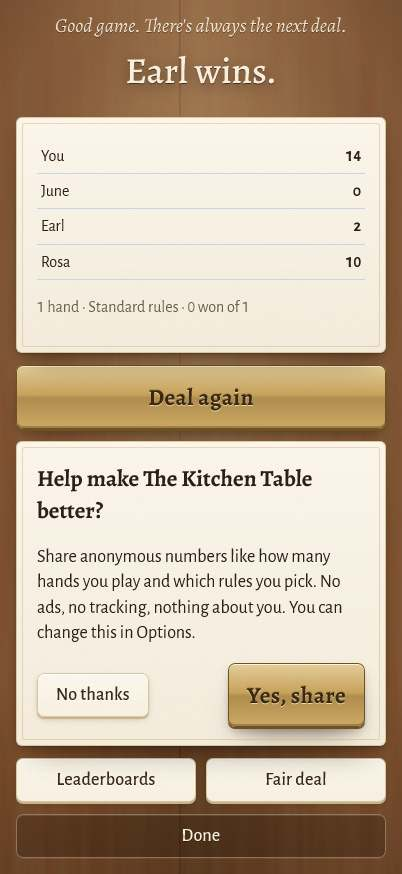
- **What's wrong:** "Yes, share" is the engraved primary button and "No thanks" is the small plain one.
- **Why it matters:** we promised no dark patterns, and Apple and EU reviewers look for equal weight on consent.
- **Fix:** two equal plain buttons, "No thanks" first.

### P1-12 · Empty states look like a broken deck
- **Screens:** 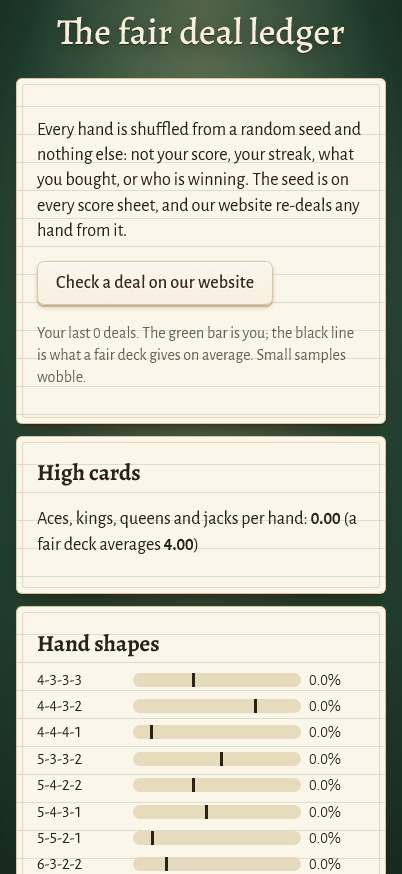 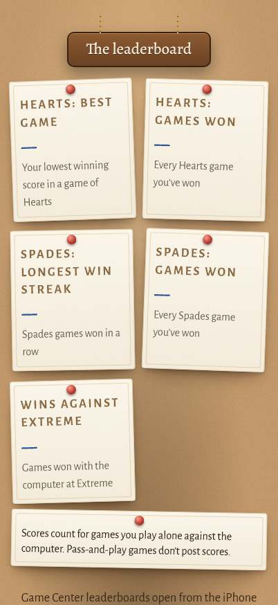
- **What's wrong:** a new player who opens Fair deal sees "Aces, kings, queens and jacks per hand: **0.00** (a fair
  deck averages **4.00**)" and every bar at 0%. Leaderboards show a dash on every card.
- **Why it matters:** the fair-deal page exists to build trust. On first open, it reads as proof of the opposite.
- **Fix:** below about 20 deals, show "Play a few hands and your own deals appear here, next to what a fair deck gives",
  with only the expected lines drawn. On the boards: "No games yet. Your first win goes here."

### P1-13 · The phone's text size is ignored, and pinch zoom is off
- **What's wrong:** sizes are fixed px, and the viewport says `user-scalable=no`. Text size only follows our own Options
  setting.
- **Why it matters:** many 60+ users set Larger Text in iOS Settings and expect every app to follow. When an app
  doesn't, a 1-star review says "text too small".
- **Fix:** on first launch, map Dynamic Type to our Text size (Capacitor's TextZoom plugin, or read
  `-apple-system-body`). Say in Options: "Follows your iPhone's text size. Change it here."

### P1-14 · iPad: you can't tell who played which card
- **Screen:** 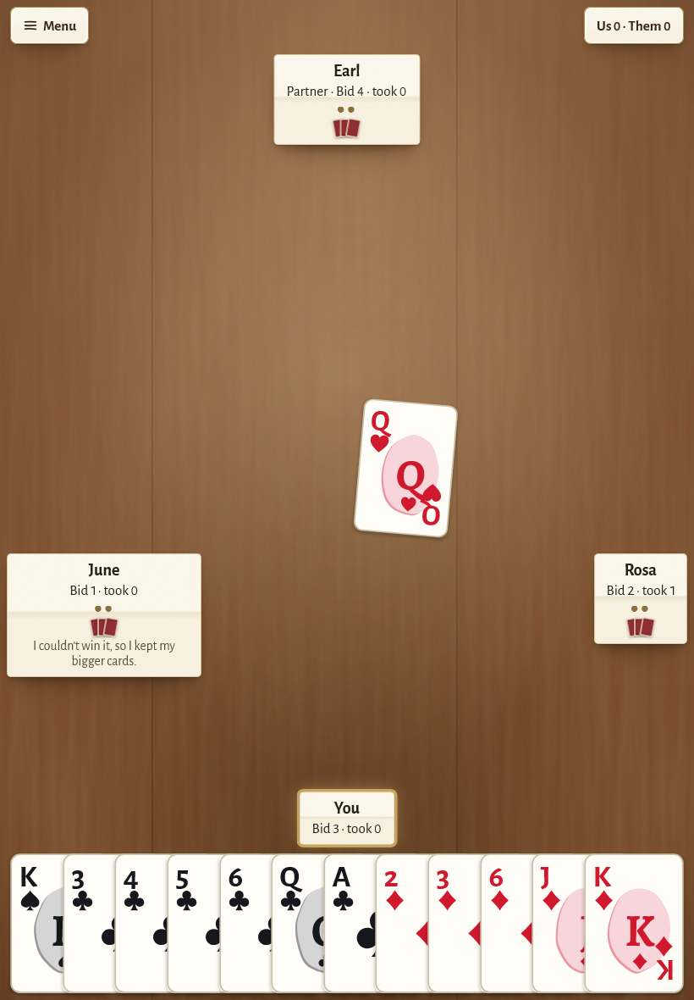
- **What's wrong:** trick cards sit within about 70 px of the centre of an 820 px table. The seats are small plates
  far away on the edges, and the felt between them is empty.
- **Fix:** scale the trick offsets with the table (toward each seat), add a small name tab under each card, scale the
  plates by about 1.3× on iPad, and use the empty felt for the lamp pool and props TABLE.md promised.

---

## P2: polish

| # | Screen | What's wrong | Fix | Shot |
|---|---|---|---|---|
| 1 | Title | Kicker "Play a game of cards at…" is 3.2:1 on the wood; the iPad title leaves big empty bands | Brighter cream or a soft shadow plate; on iPad, scale the still life up | `pro-title.jpg`, `ipad-title.jpg` |
| 2 | Title | "Fair deal" means nothing to a new player; "Games and rules" opens "The game cupboard" | "Is the deal fair?"; one name for the cupboard | `pro-title.jpg` |
| 3 | Cupboard | Boxes don't look tappable; "Coming soon, free with Everything" mixes "free" with a paid product | A small "Play ›" plate under each box; "Coming soon. Included in Everything." | `pro-picker.jpg`, `locked-picker.jpg` |
| 4 | Setup | "Blind nil… 0 turns it off." is slider language next to an "Off" value | Write the explanation for the control shown | `pro-setup.jpg` |
| 5 | Table (Hearts) | Score chip "You 0 · J 0 · E 0 · R 0": initials are cryptic | First names, or "You 0 · low score wins" plus the leader | `pro-hearts-pass.jpg` |
| 6 | Table (Spades bid) | No help for a new bidder | A "Suggest" button: the Standard bot's bid with its Why sentence | `pro-spades-bid.jpg` |
| 7 | Score sheet | The seed breaks mid-group ("3AZB-XX / HM-JW16") in Courier; no "first to 500" progress; no `h1` | Break only at hyphens, use a calmer monospace, add "First to 500: you need 455 more", make "Hand 1" the `h1` | `pro-spades-sheet.jpg` |
| 8 | Results (Hearts) | Players listed in seat order, but low score wins | Rank them, 1st to 4th, with the winner on top | `pro-hearts-results-lost.jpg` |
| 9 | Shop | Opens with a 60-word centred thank-you; captions are 14.4 px (floor is 15); 21 card backs come before anything for sale | One left-aligned line of thanks; captions at `--fs-s`; collapse the backs fan to one row with "Show all" | `pro-shop.jpg`, `pro-shop-2.jpg` |
| 10 | Unlock | The headline "Everything" is abstract; the "$9.99 for 30 days" comparison reads as salesy inside the app | "All games, $6.99 once" over the Spades and Euchre boxes; keep the comparison for the listing | `locked-unlock.jpg` |
| 11 | Leaderboards | Uppercase tracked titles at 4.4:1; the cork note at 3.2:1 | Darken `.label` to `#6f5233`; put the note on paper | `pro-boards.jpg` |
| 12 | Options | "Tap twice to play" shows On under Comfort and can't be turned off; Reading speed appears only after the switch | "(part of Comfort)" and disabled; always show speed, dimmed | `pro-options.jpg` |
| 13 | Caregiver | VoiceOver reads the PIN dots as "black circle, white circle"; ⌫ has no name; "Wrong PIN" isn't announced; no word on a forgotten PIN; no text-size preview (DESIGN §6.2); "Extreme" wraps alone | `aria-label="2 of 4 digits"`, `aria-label="Delete"`, a live region; "Forgot the PIN? Delete and reinstall the app. Purchases come back with Restore; stats don't."; add the preview | `pro-pin.jpg`, `pro-caregiver.jpg` |
| 14 | Grown-up gate | Press-and-hold can't be done from a keyboard or Switch Control | Also accept holding Space or Enter; with Switch Control, a second "Open" confirm | `pro-gate.jpg` |
| 15 | Fair deal | The ledger's green rules run through the text lines | Match the rule spacing to the line height, or rule only the bar charts | `pro-stats.jpg` |
| 16 | How to play | One dense paragraph; DESIGN §4's "try a trick" walkthrough isn't there | Five short steps with a drawn trick; a "Try a trick" button that deals five cards | `pro-howto.jpg` |
| 17 | Table (look) | Plain wood with no lamp pool, props or haze, the plainest screen in the app (TABLE.md "Screens in the look") | A warm lamp pool under the trick and one prop at an edge on Pro and iPad sizes (slid away in Comfort and on SE, TABLE rule 4) | `pro-spades-play.jpg` |
| 18 | Spades setup | The rules list stops at 6 with no "and more" | "+4 more rules" link to How to play | `pro-setup.jpg` |

## What the reviews would say

**1 star:** "My mom's cards showed while we passed the iPad around." · "Says it works with VoiceOver. It reads names
and nothing else." · "Comfort mode on my iPhone SE: the cards cover the table." · "I hit End game by mistake and lost a
game I was winning."

**5 stars:** "No ads, ever, and it means it." · "It feels like my grandmother's kitchen." · "The partner plays like a
person, and when it doesn't, I can ask it why." · "Big cards, nothing rushes me, and my daughter locked the settings so
I can't break it."

## The 10 changes I'd make first

1. **Pass-and-play cover:** `#hand` in its own stacking context, the hand cleared and the table `inert` behind the
   cover, plus a smoke check (P0-1).
2. **VoiceOver labels** for seats, the score chip and trick cards, with the seat's state and the Why sentence (P0-2).
3. **An announcement queue:** one sentence per trick end, never overwritten, bots waiting for VoiceOver (P0-3).
4. **Focus management:** the new screen's heading gets focus; dialogs take focus, are labelled and give it back
   (P0-4).
5. **Comfort on SE:** no lift on select, a one-line "You" strip, a labelled trick row (P1-1). Add the matching smoke
   checks.
6. **"Your turn: tap a card"** prompt, and a visible **Why?** tab whose answer shows in the centre (P1-2, P1-3).
7. **Comfort's 7:1 palette** and the four-colour deck switched on with it; a paper chip under the bid number; switch
   tracks at 3:1 (P1-5, P1-6).
8. **Confirm "End this game"**, close the peek between hands, and make the consent buttons equal (P1-7, P1-4, P1-11).
9. **Setup:** full-width presets and a pinned Deal bar. Group labels for every segmented control and select (P1-8,
   P1-9).
10. **Shop and first-run trust:** named buy buttons, "Try at the table", and kind empty states for Fair deal and
    Leaderboards. Follow the iPhone's text size (P1-10, P1-12, P1-13).

iPad (P1-14) and the P2 table follow, with the table's look (P2-17) as the first polish item.
