# Review: UX, accessibility and look (passover 2)

*2026-10-20, Playbook Phase 2b step 4. No app code changed by this review. Judged build: **main `f39c231` (W2) plus
PR #18 at `23fbab4`** (W3), run locally. PR #18 was still open when this was written; its head has since moved to
`f1da006`, which makes Euchre, Oh Hell and Whist deal by the cut, so the cut ritual below is now live for those three
games, not dormant. #18's `screens` CI job was red at `23fbab4` on `check-cards` (Q and 10 faces overlap the corner
index); PR #19 (cards-tactile) is the fix. Compare with [REVIEW_UX.md](REVIEW_UX.md) (passover 1).*

## Verdict

W3 did most of what passover 1 asked. The pass-and-play cover holds, every seat, the score chip and the trick cards
read as full sentences, focus lands where it should, Comfort selects without lifting and draws the trick as a labelled
row, the setup screen has full-width presets and a pinned Deal bar, End game asks first, the consent buttons are equal,
and the empty Fair deal and Leaderboards screens are kind. The ledger now looks like what it is: honest numbers with a
band.

**One P0 remains, and five new P1s**, all in places the first review never reached:

1. **VoiceOver on a real iPhone still loses half the game.** The queue works, but it only holds back the bots when it
   knows VoiceOver is running, and the plugin that tells it isn't installed. On the phone, 29 of 58 sentences in a hand
   are shown; Options promises the opposite.
2. **Extra-large text on an iPhone SE breaks the table**: the bid pad, the Euchre calling pad and the Why answer sit on
   the seats. Now that the app follows the phone's text size, many of our players get Extra large without choosing it.
3. **Comfort on SE hides the seat names** behind the Why? tabs for the whole hand.
4. **The new games' key cards are tiny**: the trump card in Oh Hell and Whist is a 45 px tilted card, and the Euchre
   upcard is 48×50 px (and gone in Comfort).
5. **The cut ritual is a dialog before every hand**, which breaks "one tap to the next deal".

Fix those and passover 2 is clean of P0/P1.

## How it was checked

- PR #18's tree (`git archive` of `23fbab4`: `proto/`, `site/`, `sim/generator.json`) served locally and driven with
  Playwright (WebKit; one Chromium run) through `proto/index.html?debug&fast`, using `window.kt` as `scripts/smoke.mjs`
  does. For each configuration: every menu screen, the setup of all five games, one whole hand of each game played by
  tapping (screenshots at each question, a mid-trick, a Why?, a selected card, late in the hand and the score sheet),
  Euchre autoplayed to the results screen, and the Fair deal ledger with 40 and 260 injected deals.

  | Prefix | Size | Mode |
  |---|---|---|
  | `pro-` | iPhone 17 Pro 402×874 | default |
  | `se-` | iPhone SE 375×667 | default |
  | `se-comfort-` | SE | Comfort |
  | `se-xl-` | SE | Text Extra large + Reduce Motion |
  | `se-comfort-xl-` | SE | Comfort + Extra large |
  | `pro-comfort-xl-` | 17 Pro | Comfort + Extra large + Reduce Motion |
  | (pro-large-chromium) | 17 Pro, Chromium | Text Large |
  | `ipad-` / (ipad-comfort) | iPad 820×1180 | default / Comfort |
  | `first-` | 17 Pro | `?locked`, empty save, by tapping only |

- Extras: the pass-and-play cover (hit-test over the hand), the menu, End confirm, score peek and Last trick; the cut
  ritual, forced on in a scratch copy because no engine dealt by the cut at `23fbab4` (`cut-`); and the live region over
  one Spades hand at normal speed, with and without `?vo` (each sentence's on-screen time against `kt.readMs`).
- Accessibility from the DOM: seat `.vh` sentences, chip and trick-card labels, focus after each question, the
  live-region log. Text sizes from computed styles. VoiceOver itself on a device is still owed (QUALITY_CHECKLIST F4).
- Screenshots: `docs/review/ux2/` (jpg, 1×).

## Passover 1 items

| Item | Status | Evidence |
|---|---|---|
| P0-1 Pass-and-play cover | **Fixed.** Hand and trick are emptied, the table is `inert`, `elementFromPoint` over the hand hits the cover | `handoff-cover.jpg` |
| P0-2 VoiceOver names | **Fixed.** "Earl, your partner, Standard. Bid 2, took 1. Double-tap to hear why."; chip "Score: us 0, them 0. Double-tap for details."; trick cards "Rosa: 4 of diamonds" | facts in every config |
| P0-3 Announcement queue | **Partly fixed: still P0** (see P0-1 below). End of trick is one sentence, Last trick is in the menu, with `?vo` nothing is replaced early | `?vo` run: 58 of 58 read |
| P0-4 Focus | **Fixed** (smoke's keyboard and dialog walks; focus goes to the hand or the pad on your turn) | |
| P1-1 Comfort on SE | **Fixed in Comfort**: a check-mark outline, "Tap it again" in the You strip, a labelled trick row. Outside Comfort, a lifted card still covers its neighbour (P2-1) | `se-comfort-xl-euchre-selected.jpg`, `pro-hearts-pass-picked.jpg` |
| P1-2 "Your turn: tap a card" | **Fixed** | `pro-spades-play.jpg` |
| P1-3 Why? | **Fixed** (a Why? tab, the answer in the say box, plates never resize), but the answer and tabs now collide on small screens (P1-2, P1-3 below) | `pro-ohhell-why-trump.jpg` |
| P1-4 Score peek | **Fixed**: a dialog of its own, closed when the hand ends | `peek.jpg` |
| P1-5 Comfort contrast | **Partly fixed.** Smoke enforces 7:1 for small print on paper; four-colour deck is on with Comfort; the stepper number sits on the brass Bid button. On-wood headings in Comfort weren't re-measured | `se-comfort-hearts-pass.jpg` |
| P1-6 Switches | **Fixed**: bordered track and On/Off beside it | `pro-caregiver.jpg` |
| P1-7 End game | **Fixed**: "End this game? Scores for this game are lost." | `end-confirm.jpg` |
| P1-8 Setup | **Fixed**: full-width presets, pinned Deal bar, "Standard rules · … See all 12" | `pro-setup-spades.jpg` |
| P1-9 Group names | **Fixed** (radiogroups, labelled selects; smoke checks) | |
| P1-10 Shop | **Fixed**: "Buy Sunday gingham, $2.99", "Try at the table" | |
| P1-11 Consent | **Fixed**: two equal buttons, No thanks first | `pro-results.jpg` |
| P1-12 Empty states | **Fixed** | `first-stats-empty.jpg` |
| P1-13 Phone text size | **In code, not verified on a device**: zoom is allowed, Options says "Starts at your iPhone's text size" | |
| P1-14 iPad | **Partly fixed**: trick cards move toward their seats and carry name tabs, a lamp pool on the felt. Plates aren't ×1.3; the bid stepper and trump card are phone-sized in a big empty table (P2-6) | `ipad-euchre-play.jpg`, `ipad-ohhell-bid.jpg` |
| P2 1-18 | Mostly fixed ("Is the deal fair?", "Play ›" plates, names on the Hearts chip, Suggest a bid, seed breaks at hyphens, goal line, "All games, $6.99 once", PIN labels and "Forgot the PIN?", How to play in steps, cup on the table, "See all 12"). **Open:** P2-1 (iPad title still has empty bands, `ipad-title.jpg`) and P2-16 ("Try a trick" slipped, as planned) | |
| R2 blind nil face down | Not walked (smoke checks it) | |
| R3 exchange panel | Unreachable: the presets are 0 until #16 lands | |
| F1 UI (cut, fingerprint) | Built; see P1-5 | `cut-pro.jpg` |
| F2-F6 UI (ledger) | **Done**, see P2-8 | `pro-stats-260-*.jpg` |

---

## P0: blocks launch

### P0-1 · VoiceOver on a real iPhone still loses about half the plays
- **Screen:** every table; Options › Accessibility.
- **What's wrong:** `announce()` keeps a queue and, when `vo` is true, the bots wait for it. `vo` comes from
  `Capacitor.Plugins.ScreenReader`, but `@capacitor/screen-reader` isn't in `package.json` or the iOS project, so on
  the phone `vo` is always false. Then the queue keeps only the last 4 sentences and the bots move every ~0.5 s. One
  Spades hand at normal speed: with `?vo`, 58 of 58 sentences were shown, none early (the hand took 115 s); without
  it, **29 of about 58** were ever shown (46 s). Options meanwhile says "every card, bid and play is announced, one at
  a time, and the table waits while VoiceOver reads."
- **Why it matters:** this was passover 1's P0-3 and the listing will say "works with VoiceOver". A blind player who
  misses half the cards can't play, and the Options sentence makes it a broken promise.
- **Fix:** add `@capacitor/screen-reader` to `package.json`, `npx cap sync ios`, and check on a device that
  `isEnabled()` turns `vo` on. Until it's verified on the phone, change the Options sentence to what is true.
- **Evidence:** live-region log, `?vo` vs plain run (this review's scratch facts); `proto/main.js` `let vo = qs.has("vo")`.

---

## P1: fix before launch

### P1-1 · Extra-large text on an iPhone SE: pads and answers sit on the seats
- **Screens:** 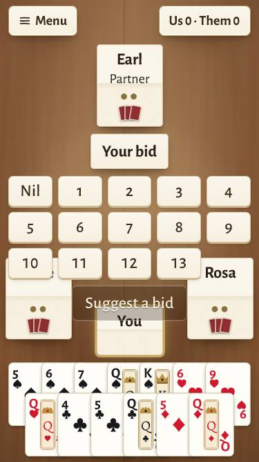 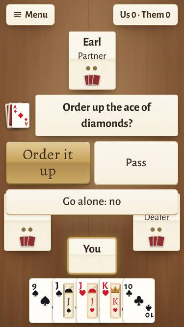 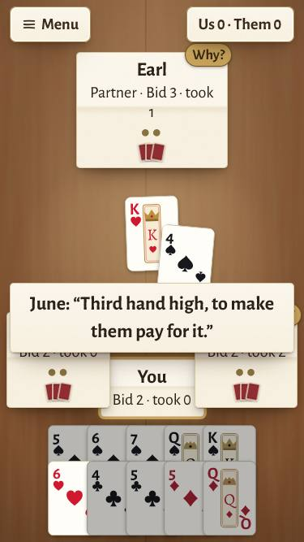
  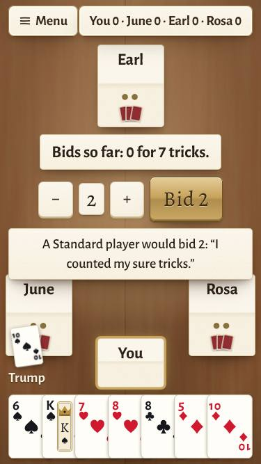 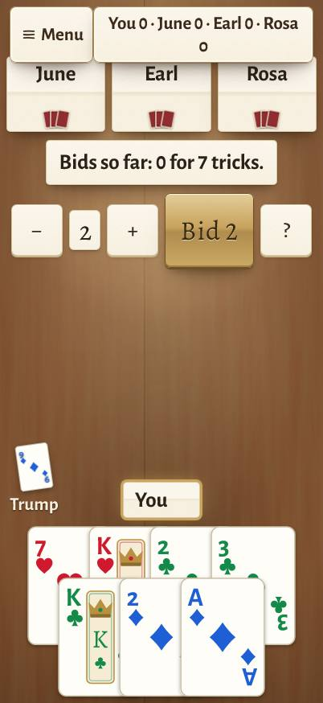
- **What's wrong:** at SE + Extra large, the Spades bid pad's fourth row covers June's plate and "Suggest a bid"
  overlaps the You plate; the Euchre calling pad covers June and Rosa, including Rosa's "Dealer" (the most important
  word in a Euchre call); a two-line Why answer covers both opponents; the Oh Hell suggest answer and the trump card
  sit on June. On a 17 Pro with Comfort + Extra large, the Oh Hell score chip wraps to two lines ("Rosa / 0") and
  overlaps the plates.
- **Why it matters:** P1-13 now starts the app at the phone's own text size, so a 70-year-old with Larger Text set in
  iOS gets this layout without choosing it. Hidden bids and a hidden dealer make the next choice a guess.
- **Fix:** let the centre panel take the space between the seat row and the You plate and scale down (bid pad: 5
  columns at XL, or the Comfort stepper whenever it doesn't fit), never over a seat. Short chip at XL ("Y 0 · J 0 ·
  E 0 · R 0" with the full sentence in its label, or the leader only). Add `smoke --se --text xl` (and `--comfort`) to
  web.yml with the existing "covers a seat" check extended to `#center` and `#say`.

### P1-2 · Comfort on SE: the Why? tabs hide the seat names
- **Screens:** 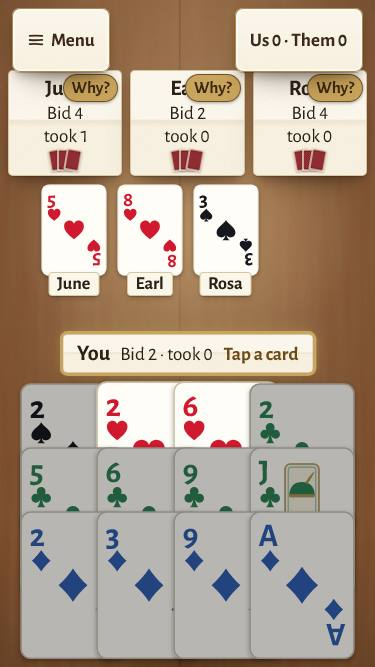 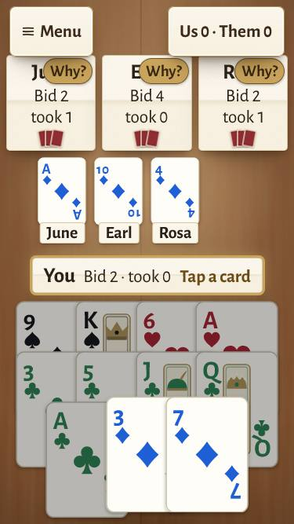
- **What's wrong:** in Comfort the three seats share one row; once a bot has played, its Why? tab sits on top of the
  plate's name, so for most of the hand the plates read "Ju", "Ea", "Ro" (just "J", "E", "R" with Extra large).
- **Why it matters:** Comfort is where Mom plays. "Who's my partner?" shouldn't need a tap.
- **Fix:** in Comfort put the Why? tab on the plate's lower edge (beside the card backs), or make the whole plate the
  Why button with a small "?" glyph after the name. Smoke: no seat's `b` (name) is covered.

### P1-3 · Comfort on SE: a Why answer covers all three seats
- **Screen:** 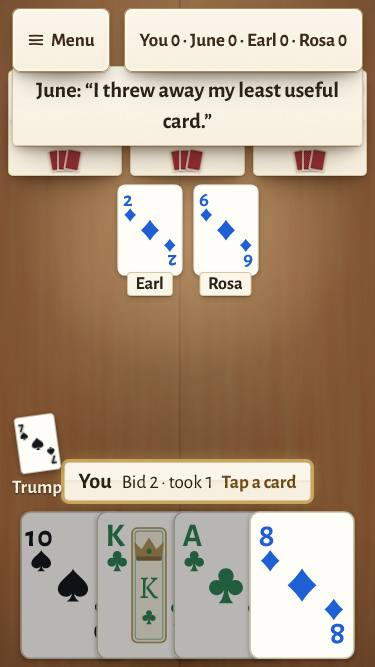
- **What's wrong:** the answer appears over the seat row (by design, since there's no room elsewhere) and stays up to
  6 s, hiding every name, bid and trick count. The Comfort "?" for Suggest uses the same place.
- **Fix:** show it in the You strip's place (the strip is already one line) or between the trick row and the hand;
  keep the seat row visible. If nothing fits, shrink the trick row while an answer is up.

### P1-4 · The trump card (Oh Hell, Whist) and the Euchre upcard are too small to read
- **Screens:** 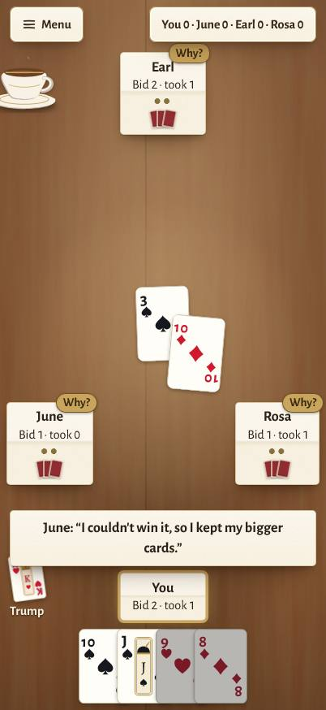 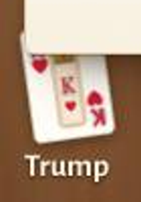
  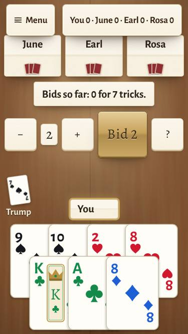 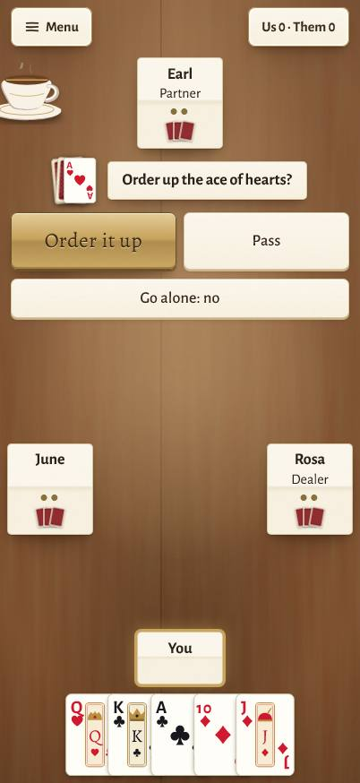 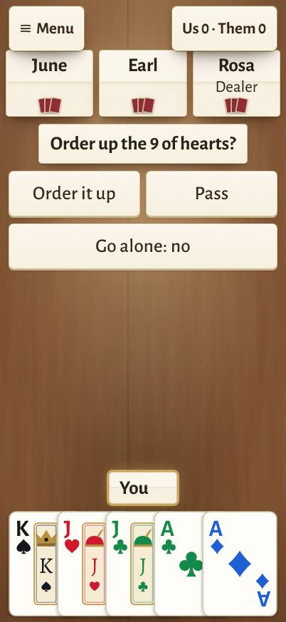
- **What's wrong:** the trump tile is a tilted card about 45×60 px in the lower-left corner with "Trump" under it; its
  index is about 9 px. On the 17 Pro a two-line say box covers its top half. In Comfort it's the same size, under
  DESIGN §6.1's 28 px glyph floor. In Euchre the upcard (the card the whole call is about) is a 48×50 px stack beside
  the prompt; in Comfort it isn't drawn at all, even on a 17 Pro with 280 px of empty felt under the pad. During Euchre
  play, trump appears only as "♥ trump" at the end of the score chip.
- **Why it matters:** trump decides every trick in these games, and the audience reads at arm's length. "What's trump
  again?" is the question a 60-year-old asks every hand.
- **Fix:** a labelled tile instead of a picture: "Trump ♥ hearts" in `--fs` on paper (plus the turned card at hand-card
  size when there's room), placed where nothing else goes (under the score chip). Euchre: draw the upcard at hand-card
  size beside the prompt in every mode that has room; keep the trump tile up during play.

### P1-5 · The cut ritual asks before every hand
- **Screens:** 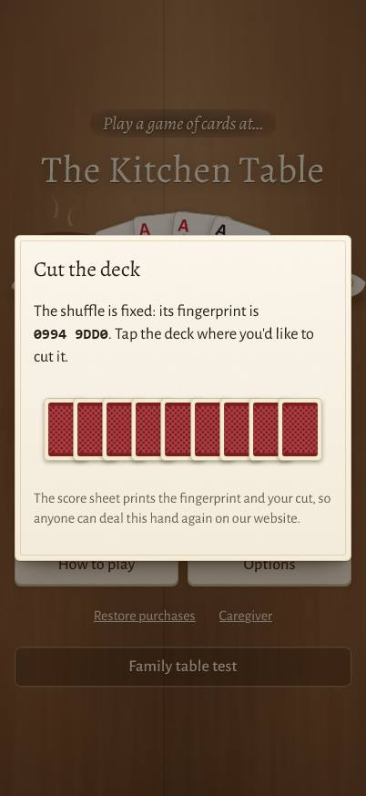 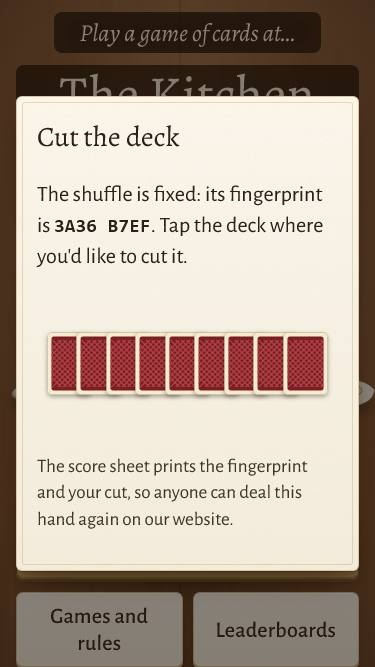
- **What's wrong:** for every human hand, `startHand()` opens "Cut the deck": a fingerprint, a row of card backs and a
  tap. As of #18's `f1da006` this is live for Euchre, Oh Hell and Whist (and for Hearts and Spades once #16 lands).
  The first hand's dialog opens over the title screen, not the table. There is no "let the dealer cut"; closing it
  without a tap cuts by the clock, which no one would guess. The fingerprint is shown with no hint of what to do with it.
- **Why it matters:** DESIGN §4: "One tap from the results screen to the next deal". A ten-hand game now has ten extra
  dialogs. Most players won't care about cutting; the ones who do will want it.
- **Fix:** Options › "Cut the deck myself" (off by default). Off: the app cuts at random and the sheet still prints
  the fingerprint and the cut, so every hand stays verifiable. On: the dialog, on the table, with a second button
  "Let the dealer cut". Keep the cut out of Comfort unless the caregiver turns it on.

---

## P2: polish

| # | Screen | What's wrong | Fix | Shot |
|---|---|---|---|---|
| 1 | Table (not Comfort) | A lifted selected card covers the neighbour's corner index (passing three in Hearts, you can't read the card to the right of a pick) | Lift less, or raise the selected card without bringing it above its right neighbour | `pro-hearts-pass-picked.jpg` |
| 2 | Oh Hell bid | "Bids so far: 0 for 7 tricks." when nobody has bid; the number shows twice (chip and "Bid 2"); Comfort's "?" could be Help | "No bids yet · 7 tricks this hand"; drop the chip; "Hint" instead of "?" | `pro-ohhell-bid.jpg`, `se-comfort-ohhell-bid.jpg` |
| 3 | Oh Hell / Whist plates | No "Dealer" on the plates or in the seat sentence (Oh Hell's hook falls on the dealer; in Whist the dealer holds the turned card) | Add "Dealer" (and "holds the trump card" in Whist) as Euchre does | `pro-whist-play.jpg` |
| 4 | Oh Hell sheet | No progress line ("Hand 1 of 13 · the game ends after the last hand"), unlike the other sheets | Add it under the totals | `pro-ohhell-sheet.jpg` |
| 5 | Euchre | "Go alone: no" is a state written as a button; no Suggest; no team count toward 3 tricks; the sheet says "Euchred You (hearts, took 1)" | A switch "Go alone" with On/Off; "Suggest a call" like Spades; "Us 1 of 3" in the chip; "You called hearts and took 1: euchred, +2 to them" | `pro-euchre-bid1.jpg`, `pro-euchre-sheet.jpg` |
| 6 | iPad table | Plates are phone-sized; the bid stepper and the trump card are small and far apart on an empty table | Plates and pads ×1.3; the pad in the middle of the felt | `ipad-ohhell-bid.jpg` |
| 7 | Score sheet | "cut 0" in the seed line reads as noise before cuts are common; the line is long | Print the cut only when it isn't 0, or move seed/cut/fingerprint behind "What is the seed?" | `first-hearts-sheet.jpg` |
| 8 | Fair deal | Rows are right but the verdict is left to the reader; the bars use about a third of the width, and a row outside its band (expected now and then) has no word of comfort | One line per section: "All 7 inside a fair deck's range" / "1 of 11 outside: about 1 in 20 is, by luck"; wider bars | `pro-stats-260-1.jpg`, `pro-stats-260-2.jpg` |
| 9 | Numbers | The zero renders at x-height, like a letter o, next to lining 1 and 4 (the owner asked for lining figures) | Check the Alegreya Sans subset carries `lnum` for 0, or self-host the full font | `crop-sheet-zero.png` |
| 10 | Title (production) | Seven taps on the kicker show "Family table test", a GameKit spike, to anyone | Only under `?debug` or a TestFlight flag | `first-title.jpg` |
| 11 | First run | A new player's first screen is "Pick 3 cards to pass left (0/3)" with no word on what Hearts is | Until "Try a trick" ships: a one-time line in the say box, "New to Hearts? Points are bad. How to play ›" | `first-hearts-pass.jpg` |
| 12 | How to play | Tabs read Hearts, Oh Hell, Whist, Spades, Euchre: not the cupboard's order | Same order as the cupboard | `pro-howto.jpg` |
| 13 | iPad title | Still empty bands above and below (passover 1 P2-1) | Scale the still life up | `ipad-title.jpg` |

## What the reviews would say

**1 star:** "Turned on VoiceOver like the app says. It skipped half the cards." · "Big text on my iPhone SE and I
can't see who bid what." · "Why do I have to cut the deck every single hand?" · "Couldn't tell what trump was."

**5 stars:** "My mom plays Euchre with the bots every night, big cards, nobody rushes her." · "I can check any hand on
their website. No other card app does that." · "When my partner plays something odd, I ask why and it tells me."

## The 10 changes I'd make first

1. **Install the ScreenReader plugin** and check `vo` on a device; until then, make the Options sentence true (P0-1).
2. **Extra-large text on SE:** pads and answers between the seats and the You plate, never on them; a short chip;
   `smoke --se --text xl` in CI (P1-1).
3. **Comfort on SE:** Why? tabs off the names, and the Why/Hint answer out of the seat row (P1-2, P1-3).
4. **A labelled trump tile** ("Trump ♥ hearts") for Oh Hell, Whist and Euchre play (P1-4).
5. **The Euchre upcard at card size**, in Comfort too when there's room (P1-4).
6. **The cut as an opt-in** in Options, with "Let the dealer cut", auto-cut and printed otherwise (P1-5).
7. **No lift over a neighbour's index** outside Comfort (P2-1).
8. **iPad:** plates and pads ×1.3, the pad in the middle of the felt (P2-6).
9. **Oh Hell clarity:** Dealer on the plates and in VoiceOver, "No bids yet", "Hand 1 of 13" (P2-2 to P2-4).
10. **Fair deal verdict lines and a true lining zero** (P2-8, P2-9).
